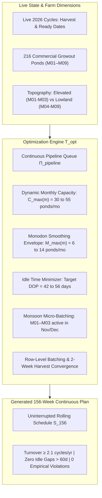

# AI Stocking Planner: Mathematical Model & Empirical Calibration Specification (V2)
**System:** iSHARP Aquaculture Platform — Production Simulation Engine  
**Calibrated From:** Setiu Shrimp Farm Operational Database (`Bab SGo (r41) 26.10.16.accdb`, $N = 7,655$ cycles)  
**Date:** October 2026

---

## 1. Empirical Ground Truth (2018–2026 Production Audit)

Deep SQL auditing of Setiu Farm's production database across 2018–2026 establishes the foundational empirical laws governing stocking, turnaround, species allocation, and seasonal adaptation.

### A. Monthly Farm-Wide Stocking Envelope (2021–2025 Recent 5-Year Norm)
Across normal commercial operations, the farm stocks an average of **509 ponds per year** (~42.4 ponds/month), following a clear seasonal envelope:

| Month | Calendar Period | Avg Total Ponds/Mo | Min Ponds | Max Ponds | Avg Monodon/Mo | Avg Vannamei/Mo | Primary Operating Context |
| :---: | :--- | :---: | :---: | :---: | :---: | :---: | :--- |
| **1** | January | **39.6** | 18 | 56 | **6.8** | 32.8 | Post-Monsoon Ramp-Up |
| **2** | February | **32.0** | 16 | 51 | **11.0** | 21.0 | Early Dry Season Expansion |
| **3** | March | **22.8** | 6 | 49 | **4.8** | 18.0 | Transition & Tidal Window |
| **4** | April | **34.0** | 26 | 48 | **9.4** | 24.6 | Spring Expansion |
| **5** | May | **50.6** | 31 | 69 | **13.6** | 36.8 | Peak Dry Season Full Load |
| **6** | June | **55.0** | 37 | 70 | **10.6** | 44.4 | Peak Dry Season Maximum Run |
| **7** | July | **52.0** | 44 | 68 | **8.6** | 43.4 | High Summer Turnover |
| **8** | August | **41.4** | 17 | 52 | **6.0** | 35.4 | Late Summer Re-stocking |
| **9** | September | **39.8** | 21 | 58 | **7.2** | 32.6 | Lowland Cut-off Preparation |
| **10** | October | **53.8** | 46 | 60 | **10.6** | 43.2 | Pre-Monsoon Push |
| **11** | November | **47.4** | 35 | 52 | **12.4** | 35.0 | Monsoon Elevated Stocking (M01–M03) |
| **12** | December | **41.8** | 30 | 52 | **11.0** | 30.8 | Late Monsoon Elevated Stocking |
| **Total** | **Full Year** | **509.4** | — | — | **112.8** | **396.6** | **22.1% Monodon / 77.9% Vannamei** |

**Empirical Takeaways:**
1. **Total Farm Monthly Envelope:** The farm maintains a steady throughput of **30 to 55 ponds per month**.
2. **Monodon Supply Smoothing:** Monodon stocking is strictly bounded between **5 and 14 ponds per month** (average ~9 to 11 ponds/month). Hatcheries (`CPM`, `OIS`, `KSK`, `CPD`, `UBN`) cannot supply massive PL surges in a single month; volume is contracted and spread steadily.
3. **No Complete Shutdown in Monsoon:** The farm stocks **41 to 47 ponds per month** even in November and December. It does *not* freeze operations farm-wide.

---

### B. Pond Idle Time (DOP / Turnaround) Analysis
Audit of $N = 3,808$ recorded pond transitions (`[idle day]` between harvest and subsequent stocking):

* **Mean Idle Time:** $71.6\text{ days}$
* **Median Idle Time:** $62.0\text{ days}$
* **10th Percentile:** $29.0\text{ days}$
* **25th Percentile:** $41.0\text{ days}$ (Matches Golden Rest target)
* **75th Percentile:** $86.0\text{ days}$
* **90th Percentile:** $128.0\text{ days}$

**Historical DOP Breakdown:**
* $< 21\text{ days}$ (Rushed Prep / Relapse Hazard): **$1.9\%$** ($N=74$)
* $21\text{--}35\text{ days}$ (Fast Turnaround): **$16.7\%$** ($N=637$)
* $36\text{--}50\text{ days}$ (Golden Rest Target): **$16.3\%$** ($N=620$)
* $51\text{--}75\text{ days}$ (Moderate Buffer): **$30.9\%$** ($N=1,178$)
* $> 75\text{ days}$ (Excessive Idle Sitting): **$34.1\%$** ($N=1,299$)

**Critical Operational Mandate:**
Over $34\%$ of ponds historically suffered excessive idle periods ($> 75$ days) due to rigid module-level bottlenecks. An intelligent AI planner must enforce:
$$\text{DOP}_{\min} = 42\text{ days (Golden Rest)} \le \text{DOP}_{p,c} \le 60\text{ days (Active Target)}$$
Ponds should not be allowed to sit idle for 120–150 days (e.g. October to March) when elevated modules can safely culture during Q4.

---

### C. Topographical Module Specialization (Lowland vs Elevated)
The 9 commercial modules behave differently across the calendar year:

| Module Group | Modules | Soil & Topography | Dry Season (Feb–Aug) | Monsoon Season (Nov–Dec) | Typical Nov/Dec Stocking |
| :--- | :--- | :--- | :--- | :--- | :--- |
| **Elevated Sandy** | **M01, M02, M03** | Sandy soil, elevated terrain, rapid drainage, no estuarine backflow. | High production, Vannamei & Monodon. | **Continuous operation.** Tolerates heavy rain; zero flood inundation risk. | **2 to 6 ponds/module/month** (Hardy SPR/Golden Vannamei micro-batches). |
| **Lowland Estuarine** | **M04, M05, M06, M07, M08, M09** | Clay/silt soil, low elevation, river mouth proximity, flood prone. | Priority conveyor belt, early Monodon window (Jan–Jul). | **Protected drainage & rest.** Avoid high-density late stocking to prevent forced harvest. | **Resting / drainage prep** or highly selective deep ponds. |

---

## 2. Mathematical Formalization of the AI Planner V2

### A. The Objective Function
The AI Planner solves a dual-objective optimization: maximize risk-adjusted EBITDA while minimizing dead idle time:

$$\max_{\mathcal{S}_{156}} \sum_{p=1}^{216} \sum_{c=1}^{C_p} \mathbb{E}[\text{EBITDA}(p, c)] - \underbrace{\lambda_{\text{idle}} \sum_{p,c} \max(0, \text{DOP}_{p,c} - 56\text{d})}_{\text{Penalty for Ponds Sitting Idle Too Long}} - \underbrace{\sum_{k} \text{Penalty}(\text{Hazard}_k)}_{\text{Biosecurity & Monsoon Violations}}$$

### B. Mathematical Constraints

#### 1. Biological Minimum Turnaround (Pillar 1)
$$\text{DOP}_{p,c} = t_{\text{stock}}(p, c) - t_{\text{harvest}}(p, c-1) \ge 42\text{ days (6 weeks Golden Rest)}$$
If cycle $c-1$ experienced pathology (`EHP`, `WSSV`, `EMS`), $\text{DOP}_{p,c} \ge 49\text{ days}$.

#### 2. Farm-Wide Monthly Capacity Envelope $C_{\max}(m)$ (Pillar 3)
$$\sum_{p \in \text{Farm}} \mathbb{I}\left( \text{Month}(t_{\text{stock}}(p)) = m \right) \le C_{\max}(m)$$
where:
$$C_{\max}(m) = \begin{cases}
40 \text{ ponds} & m = 1 \text{ (Jan)} \\
35 \text{ ponds} & m = 2, 3 \text{ (Feb, Mar)} \\
45 \text{ ponds} & m = 4 \text{ (Apr)} \\
55 \text{ ponds} & m = 5, 6, 7 \text{ (May, Jun, Jul — Peak Dry)} \\
45 \text{ ponds} & m = 8, 9 \text{ (Aug, Sep)} \\
55 \text{ ponds} & m = 10 \text{ (Oct — Pre-monsoon push)} \\
48 \text{ ponds} & m = 11, 12 \text{ (Nov, Dec — Elevated M01–M03 continuous culture)}
\end{cases}$$

#### 3. Monodon PL Hatchery Supply Smoothing Envelope $M_{\max}(m)$ (Pillar 0)
To avoid exceeding hatchery capacities (`CPM`, `OIS`, `KSK`), Monodon allocation is smoothed:
$$\sum_{p \in \text{Farm}} \mathbb{I}\left( \text{Month}(t_{\text{stock}}(p)) = m \land \text{Species}(p) = \text{MONODON} \right) \le M_{\max}(m)$$
where $M_{\max}(m) \in [6, 14]\text{ ponds/month}$ ($\approx 1.2\text{M to } 2.8\text{M PLs/month}$).
- Lowland modules (M04–M09) are allocated Monodon strictly during **Months 1 to 7** (harvesting before October floods).
- Elevated modules (M01–M03) absorb Monodon allocations in safe seasons and maintain supervisor equity (1 Monodon row batch per module per year).

#### 4. Elevated Monsoon Continuous Culture Rule (Modules 01, 02, 03)
When an elevated module row completes harvest and passes its 42-day Golden Rest in Q4 (Oct, Nov, Dec):
- It is **not** postponed to Q1/Q2 of next year.
- It immediately receives a **Monsoon Micro-Batch** (2 to 6 ponds) using hardy Vannamei SPR / API Golden (Strategy `DS1`, single terminal harvest, density $90\text{--}96\text{ PL/m}^2$).
- This completely eradicates the artificial 5-month dead zone.

#### 5. Row-Level Atomic Batch Stamping with Asymmetric Harvest Convergence (Pillar 2 & 4)
- **Standard Culture Strategy (Single Terminal Harvest Default):**
  - **No Automated Partial Harvest:** Partial harvesting (`DS2`) is **strictly excluded** from the automated AI standard schedule. As established by farm supervisors, netting and partial harvesting causes severe physical stress, water quality agitation, and spikes mortality risk in the remaining stock.
  - **AI Standard Default:** All automated planning strictly defaults to **Strategy `DS1` (Direct Stocking 1X — Single Terminal Harvest)** for *L. vannamei* and **Strategy `DS4` (Single Terminal Harvest)** for *P. monodon*. Partial harvesting remains strictly an on-demand elective feature requested manually by supervisors.
- **Harvest Convergence Alignment:**
  - **Row 1:** 12 ponds stamped with *P. monodon* (`DS4`) at Week $W$ ($\text{DOC} = 112\text{d}$, duration $\approx 16$ weeks).
  - **Row 2:** 12 ponds stamped with *L. vannamei* (`DS1`) at Week $W + 3$ ($\text{DOC} = 91\text{d}$, duration $\approx 13$ weeks).
  - **Simultaneous Harvest:** Both rows achieve single terminal harvest in Week $W + 16$!
  - **Unified Rest:** Module enters 42-day Golden Rest as a unified 24-pond block, ensuring $100\%$ All-In/All-Out biosecurity with zero netting disturbance.

---

## 3. Implementation Checklist for `/boost`

1. **`constraintScheduler.js`:**
   - [ ] Update `MONTHLY_CAPACITY_ENVELOPE` with empirical monthly values ($35\text{--}55$ ponds/mo).
   - [ ] Implement `MONODON_MONTHLY_SUPPLY_CAP` ($6\text{--}14$ ponds/mo smoothing).
   - [ ] Eliminate the blunt Q4 postponement rule: replace with the **Elevated Monsoon Micro-Batching Rule** for M01, M02, M03.
   - [ ] Prevent ponds from sitting idle $> 60$ days when their module is eligible for a wave.
2. **`simulationStore.js`:**
   - [ ] Ensure `moduleInitialReadyWeeks` passes live ready dates for each module row without calendar freezing.
3. **Verification:**
   - [ ] Verify Module 2 rows no longer stay idle from October to March.
   - [ ] Assert full 156-week plan achieves $\ge 2.1$ cycles/pond/year with zero empirical violations.
   - [ ] Ensure all 171 automated unit tests pass.
