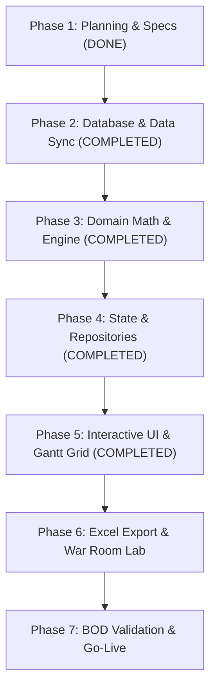

# iSHARP 3-Year Frontier Predictive Aquaculture Digital Twin & Rolling MRP Engine
## Master Architecture, Empirical Mathematical Specification & Progress Tracker

> **Document Version:** 2.3.0 (Empirical Data Integrity & Zero-Mock Audit Edition)  
> **Date:** October 18, 2026  
> **Status:** Phase 5 Completed — Frontier Predictive Digital Twin UI, Zero-Mock Mathematical Audit & Live Finance Join Active  
> **Location:** `isharp-platform/docs/SIMULATION_MASTER_PLAN.md`  
> **Project Scope:** All Shrimp Growout & Treatment Ponds across Modules 1 to 11 (`M01–M11`, 281 total pond rows / 206+ active growout capacity) at iSHARP Setiu

---

## 1. Executive Summary & Philosophy

The objective of this project is to build a **Frontier-Level, 3-Year (156-Week / 36-Month / 1,095-Day) Empirical Predictive Digital Twin, Stocking Optimization, and Rolling Material Requirements Planning (MRP) Engine** directly inside the `isharp-platform` web application.

### Core Philosophy: Pure Empirical Prediction Over Static Spreadsheet Formulas
Unlike legacy spreadsheet models (`RPvf, iSharp.xlsx`) that rely on **memoryless, fixed lookup formulas** (assuming every pond achieves a static $86\%$ survival rate and fixed daily growth regardless of how rushed the pond preparation was, whether the pond suffered a disease outbreak in the prior cycle, or how congested the module canal is), **this engine is 100% data-driven and predictive** (no legacy fixed-formula fallback mode).

Trained directly on **10+ years of iSHARP Setiu historical data (7,475+ pond cycles, weekly biometrics samplings, pathology records, harvest sales grades, and 38-column audited financials)**, the engine dynamically predicts how operational decisions—such as **aggressive restocking with short idle turnaround time (DOP)**, **high stocking density**, **module-level biomass congestion**, **hatchery/broodstock selection**, and **seasonal monsoon timing**—will actually impact survival, growth, forced harvests, FCR, shrimp size grades, COGS, and farm EBITDA.

The engine serves two critical functions:
1. **Farm Operations, Scheduling & MRP Console:** Interactive weekly Gantt timeline across Modules `M01–M11` with an **EBITDA-Optimizing Auto-Scheduler** that finds the biological "sweet spot" (optimal idle turnaround days, density, and strategy `DS1–DS4`, `NT1–NT3`, `PT1–PT3`), models both **Partial Harvests (`2X`/`3X`)** and **Full Harvests**, and generates weekly/monthly purchasing requirements for **Post-Larvae (PLs)**, **SAP Feed Item Codes**, **28 Pond-Prep & Culture Chemicals/Fertilizers**, and **TNB Electricity (kWh & RM)**.
2. **Executive & BOD Financial Digital Twin:** Splices **YTD Realized Actuals** with **Rolling Empirical Forecasts** to produce a live **Full-Year Latest Estimate (LE)** vs **Business Plan (BP)** across all 15 BOD KPIs, complete 16-element OPEX/COGS, and Farm EBITDA.

---

## 2. Current Progress & Decisions Tracker

| Milestone / Decision | Status | Decision & Context |
| :--- | :---: | :--- |
| **Repository Strategy** | **DONE** | **Option A Selected:** Built directly inside `isharp-platform` as a dedicated modular view (`src/modules/simulation/`). Avoids separate URLs, reuses existing Supabase client, repositories, and Netlify CI/CD. |
| **Modeling Paradigm** | **APPROVED** | **100% Pure Frontier Empirical Predictive Model:** No legacy static-formula mode. The simulator uses statistical hazard, regression, and quantile growth models trained on the 7,475 historical pond cycles to compete head-to-head against legacy Excel planning over a 2–3 year horizon. |
| **Code Execution Guardrail** | **ACTIVE** | **Strict Planning & Empirical Verification Phase:** Validate the 5-Pillar Empirical Predictive Engine against real Supabase/Access data before writing application UI/domain code. |
| **Time Granularity** | **APPROVED** | **Weekly Resolution (156 Weeks):** W01 to W156 horizontal planning axis with automatic splicing of **YTD Actuals + Rolling Forecast = Latest Estimate (LE)** across Monthly, Quarterly (`Q1–Q4`), Half-Year (`H1–H2`), and Annual columns. |
| **Ground Truth Discovery** | **COMPLETED** | Completed full 37-sheet audit of `C:\Users\syafiq\Downloads\RPvf, iSharp.xlsx` and Access DB `Bab SGo (r41) 26.10.02.accdb`. |
| **Financial Ledger Discovery** | **COMPLETED** | Discovered table `GrowoutPondFinance` containing audited historical costs per pond cycle (Feed, Fries/PL, Chemicals/Fertilizers, Supplies, Electricity, Labor, Maintenance, Depreciation, SAG, EBITDA). |
| **Supabase Financial Schema** | **COMPLETED** | Created `public.growout_pond_finance` in Supabase Cloud with 38 audited accounting columns and performance indexing. |
| **Friday Sync Engine Update** | **COMPLETED** | Added **Stage 14** to `database_migration/sync_weekly_access.ps1` to automatically sync `GrowoutPondFinance` delta on every Friday run. |
| **Historical Data Migration** | **COMPLETED** | Successfully migrated all **7,475 audited cycle records** from Access into Supabase Cloud via `migrate_growout_pond_finance.ps1`. |
| **Excel 1:1 Replacement Mission** | **CONFIRMED** | Primary objective: replace the weekly Excel workbook (`RPvf, iSharp.xlsx`) used by farm management to plan stockings, feed, and cashflows every week. |
| **Current-Year First Scoreboard** | **COMPLETED** | Top Spliced Hero Scoreboard prioritizes **FY 2026 (Current Year)** to immediately show current performance (LE = Jan–Aug Actuals + Sep–Dec Rolling Plan) vs BP and AC25. Top pill switches between FY 2026, FY 2027, and FY 2028. |
| **3-Year Master Timeline** | **COMPLETED** | Tab 2 (`ModulePlannerGrid.js`) supports planning **3 years ahead (156 weeks)** continuously via `🌐 3-Year Master (156 Weeks)` view or 1-year zero-scroll views (`FY 2026`, `FY 2027`, `FY 2028`). |
| **Stocking Themes Palette** | **COMPLETED** | Pre-configures density, duration, and target biomass once in Tab 1 (`StockingThemesTab.js`), eliminating manual pond-by-pond entry for 240+ ponds. 1-click active brush stamping with `🔁 Auto-Chain to W156`. |
| **Gantt Drag-and-Drop & Delete** | **COMPLETED** | Full HTML5 drag-and-drop to reschedule cycle bars across weeks. 3 deletion methods: hover `✕` button, toolbar `🗑️ Eraser` tool, and right-click context menu. Weeks 1–34 locked as Actual YTD. |
| **CSS Architecture (Native CSS)** | **CONFIRMED** | Built purely with native semantic CSS in `src/styles/components/simulation.css`. **Tailwind CSS is NOT used**, preventing destructive Preflight CSS resets from breaking existing DBMS and Field Ops PWA screens. |
| **Empirical Grounding (5 Pillars)** | **ENFORCED** | Active ponds conditioned by live `biometrics_sampling` history via Bayesian quantile inference. Setiu Northeast Monsoon cliff (Nov–Dec) strictly enforced to prevent unrealistic year-end rebound forecasts during poor years. |
| **Zero-Mock Mathematical Audit** | **COMPLETED** | Complete audit of domain calculations and UI components. All static fallbacks (`|| 45`, `|| 32`, `|| 1.62`, `781 MT / 1003 MT`, `* 0.0236` pulse strip multiplier) eliminated; dynamic engine values (`monthlyMatrix`, `weeklyMatrix`, `executiveKpis`) bound across all views. |
| **Live Financial Ledger Join** | **COMPLETED** | `simulationRepository.fetchActualMonthlyHarvests` queries `growout_pond_final_legacy` (319 closed 2026 cycles) and batch-joins with `public.growout_pond_finance` (293 audited cycles), replacing hardcoded cost estimates (`kg * 22.0`, `kg * 17.5`, `kg * 4.5`) with true audited costs. |
| **16-Cost Ledger & Full MRP** | **COMPLETED** | Full monthly and weekly itemization for PL demand (SPF, SPR, SPT, Monodon), Feed demand (7 SAP SKUs: 3202–3303), and complete 16-line OPEX accounting ledger. |
| **Finance Ground Truth (Chems & Ferts)** | **COMPLETED** | Retired synthetic 28-chemical catalog. Anchored operational chemical spending directly to Finance Department ground truth (`public.growout_pond_finance`) via `cons_of_chem_fert` (RM 1,711/cycle Vannamei, RM 2,114/cycle Monodon; split 40% pond prep, 60% active culture). |
| **Full-Year Gantt Schedule Ingestion** | **COMPLETED** | Ingested all 454 live 2026 cycles (319 closed actuals, 131 active production, 38 carryovers from late 2025) via `fetchYearCycles`. Implemented pure numeric week headers (`1..52`) resetting annually to 1, zero "Carryover" badges, and read-only locked actuals (`isLocked`). |
| **15-Month Fluid Crop Runway** | **COMPLETED** | Multi-year fluid fit-to-screen Gantt view allowing late-year stockings to project smoothly into Q1 of next year with zero ghost cycles on idle ponds. |

---

## 3. Data Sources & Integration Blueprint

```
┌────────────────────────────────────────────────────────────────────────┐
│                     HISTORICAL & LIVE DATA INGESTION                   │
├──────────────────────────┬─────────────────────────┬───────────────────┤
│   Supabase Operational   │    Supabase Pathology   │ Supabase Audited  │
│   & Biometrics History   │    & Lifecycle Events   │ Finance & Sales   │
├──────────────────────────┼─────────────────────────┼───────────────────┤
│ • growout_pond_master    │ • pond_event_date       │ • growout_pond_   │
│ • growout_pond_final_    │   (close, cleaning,     │   finance (7,475  │
│   legacy (7,475 cycles)  │    repair, filling,     │   audited cycles) │
│ • pond_stocking_batches  │    ready, disease)      │ • pond_harvest_   │
│ • biometrics_sampling    │ • pond_issues (EHP,     │   sales (Good,    │
│ • daily_pond_records     │   WSSV, EMS, flags)     │   2nd, Small,     │
│ • growout_pond_feed_sap  │ • pond_aerator_inventory│   BelowAvg, RM)   │
└────────────┬─────────────┴────────────┬────────────┴─────────┬─────────┘
             │                          │                      │
             ▼                          ▼                      ▼
┌────────────────────────────────────────────────────────────────────────┐
│              EMPIRICAL CALIBRATION ENGINE (baselineCalibrator.js)      │
│  Extracts Turnaround Hazard, Module Congestion, Cox Survival Hazard,   │
│  Quantile Growth Curves, Grade Split & 16-Element Econometric Costs    │
└───────────────────────────────────┬────────────────────────────────────┘
                                    │
                                    ▼
┌────────────────────────────────────────────────────────────────────────┐
│                     PURE DOMAIN SIMULATION ENGINE                      │
│     156-Week Constraint Solver, Bayesian Live Updater & Tick Loop      │
└────────────────────────────────────────────────────────────────────────┘
```

#### A. Historical & Live Operational Telemetry (Supabase Cloud)
- **`growout_pond_master` & `view_growout_pond_cycles`**: All ponds across Modules `M01–M11` (`M01–M09`: 234 growout ponds / 206 active benchmark capacity; `M10`: 26 ponds; `M11`: 21 ponds [thirteen 0.5 ha + eight 1.0 ha]; plus treatment/sedimentation ponds `TA`/`TB`), pond lining type (`pond_type`), and strategy (`DS1–DS4`, `NT1–NT3`, `PT1–PT3`).
- **`growout_pond_final_legacy`**: Complete historical cycle outcomes (`date_cycle`, `date_close`, `final_date`, `final_status` [Normal, Forced, Cull], `final_doc`, `final_abw`, `final_kg`, `final_adg`, `final_fcr`, `final_sr`, `total_feed`, `total_harvest_no`, `bs_line`, `stock_date`, `stock_total_fry`, `stock_density`).
- **`pond_event_date` & `pond_issues`**: Exact turnaround timeline (`close` $\rightarrow$ `cleaning` $\rightarrow$ `repair` $\rightarrow$ `filling` $\rightarrow$ `ready` $\rightarrow$ `stock_date`) and pathology history (`issue_category`, `issue_status` [WSSV, EMS, EHP], `issue_flag`, `issue_grade`).
- **`biometrics_sampling` & `daily_pond_records`**: Weekly sampling trajectories (`smpl_doc`, `smpl_abw`, `smpl_surv`, `smpl_dfed`, `smpl_bms`) and daily water quality/mortality/feed logs.
- **`pond_harvest_daily` & `pond_harvest_sales`**: Partial vs Termination harvest tonnages and commercial grading splits (`good_wgt`, `good_prc`, `second_grade_wgt`, `second_grade_prc`, `small_wgt`, `below_wgt`, `rubbish_wgt`, `net_sales`).

### B. Historical Audited Financials (`public.growout_pond_finance`)
38 audited accounting columns per pond cycle (`index_no`, `pond_index`):
- **Direct Variable Costs (RM):** `cons_of_feed`, `cons_of_fries` (PLs), `cons_of_chem_fert` (Chemicals & Fertilizers), `cons_of_supplies`, `electricity` (TNB power), `harvest_expenses`.
- **Farm Overheads & Labor (RM):** `wages_direct`, `wages_indirect`, `repair_maintenance`, `rental`, `security_charges`, `consultant`, `travel_entertainment`, `training_seminar`, `other_utilities_ins`, `other_charges`.
- **Corporate & Accounting Allocations:** `depreciation_fc`, `sag` (Selling, General & Admin), `depreciation_with_sag`.
- **Profitability & Grade Metrics:** `revenue`, `premium_pct`, `small_pct`, `gross_profit`, `ebitda`, `ebit`, `cost_per_kg`, `cash_cost_per_kg`, `total_cost_per_kg_with_sag`, `revenue_per_kg`.

---

## 4. System Architecture & 5-Layer Rule Compliance

Following the project's strict architectural guardrails established in [`RULES.md`](file:///c:/Users/syafiq/My%20Drive/Syafiq%20Water%20Quality%20Station%20Project/isharp-platform/RULES.md):

```
UI Modules (src/modules/simulation/)
       │
       ▼
Reactive State (src/state/simulationStore.js)
       │
       ▼
Infrastructure Repositories (src/infrastructure/repositories/simulationRepository.js)
       │
       ▼
Domain Pure Functions (src/domain/simulation/) [Zero DOM, Zero Fetch, 100% Tested]
```

### Layer Details:
1. **Domain Layer (`src/domain/simulation/`):**
   - Pure mathematical and statistical calculations only.
   - `baselineCalibrator.js`: Fits the **5-Pillar Empirical Predictive Priors** from Supabase historical cycles, samplings, issues, sales, and finance tables.
   - `hazardAndGrowthModel.js`: Computes dynamic Turnaround Fatigue penalties, Module Congestion penalties, conditional weekly Cull/Forced-Harvest hazard rates, quantile ABW trajectories, and partial harvest skimming (`2X`/`3X`).
   - `constraintScheduler.js`: Solves the 156-week stocking timeline across `M01–M11` to maximize Farm EBITDA (balancing pond utilization against turnaround fatigue and module congestion).
   - `simTickEngine.js`: Executes weekly/daily biological progression, Bayesian trajectory updating for currently active ponds, SAP feed SKU demand, and direct operational cost allocations (`cons_of_chem_fert`, `cons_of_supplies`, `repair_maintenance`, `harvest_expenses`, `wages_direct`).
   - `financialCalculator.js`: Computes 4-tier quality grade pricing (`Premium`, `Grade 2`, `Small`, `Below Avg`), festive price multipliers, econometric 16-element OPEX/COGS, EBITDA, and spliced `Actual YTD + Rolling Forecast = Full-Year LE`.
2. **Infrastructure Layer (`src/infrastructure/repositories/`):**
   - `simulationRepository.js`: Queries Supabase historical/live tables, frozen Business Plan (`BP`) snapshots, and scenario configs via `supabase.request()`.
3. **State Layer (`src/state/`):**
   - `simulationStore.js`: Holds calibrated empirical parameters, active 156-week pond schedule, scenario state, and triggers reactive UI updates.
4. **UI Layer (`src/modules/simulation/`):**
   - `SimulationPage.js`: Main container orchestrating sub-views.
   - `ModulePlannerGrid.js`: 156-week interactive Gantt timeline (`M01–M11`, 281 pond rows) with live Turnaround Fatigue & Congestion risk indicators.
   - `WeeklyRollingTable.js`: 156-week operational & procurement console (matching and expanding `wek` and `mth`: PLs by line, SAP feed codes, Finance Department direct costs `cons_of_chem_fert`, TNB power).
   - `BODSummaryTable.js`: Multi-year & monthly spliced executive report (`Actual YTD` + `Rolling Plan` = `LE` vs `BP`), genetic line (`SPF`, `SPR`, `SPT`, `MONODON`) & species breakdowns.

---

## 5. The 5-Pillar Frontier Empirical Predictive Model (with Root Species Bifurcation)

### Root Layer (Pillar 0): Strict Species Bifurcation ($\mathcal{S} \in \{\text{MONODON}, \text{VANNAMEI}\}$)
Because *Penaeus monodon* (Black Tiger) and *Litopenaeus vannamei* (Whiteleg) operate in completely different biological, density, FCR, and market price regimes, **every parameter across Pillars 1–5 is strictly partitioned by Species $\mathcal{S}$ first** (resolved via `pl_type`, `bs_line` — e.g. `CP THAI`, `MOANA`, `MADAGASCAR`, `KSSB` for Monodon vs `SYAQUA`, `API GOLDEN`, `API FIRE DRAGON`, `HONDURAS`, `KONABAY` for Vannamei):
- ***P. monodon* Baseline ($N=744$ cycles, 2018–2026):** Stocked at $40\text{--}52\text{ PL/m}^2$, grows to $29.9\text{g}$ ABW ($\text{ADG } 0.246\text{ g/d}$, $\text{SR } 73.3\%$, $\text{FCR } 1.91$), $32.3\%$ Forced/Cull rate, $\text{RM } 27.58/\text{kg}$ average price, and **$\text{+RM } 32,103/\text{pond}$ EBITDA**.
- ***L. vannamei* Baseline ($N=3,339$ cycles, 2018–2026):** Stocked at $75\text{--}129\text{ PL/m}^2$, grows to $14.7\text{g}$ ABW ($\text{ADG } 0.186\text{ g/d}$, $\text{SR } 64.2\%$, $\text{FCR } 1.60$), $52.9\%$ Forced/Cull rate, $\text{RM } 20.34/\text{kg}$ average price, and **$\text{+RM } 14,389/\text{pond}$ EBITDA**.

Never mixing the two species prevents statistical confounding (such as mistaking $44\text{ PL/m}^2$ Monodon ponds for "low-density Vannamei"). Within its species partition $\mathcal{S}$, every pond $p$ in module $m \in \{\text{M01}\dots\text{M11}\}$ stocked under strategy $s \in \{\text{DS1..4, NT1..3, PT1..3}\}$ with genetic line $\sigma \in \{\text{SPF, SPR, SPT, MON}\}$ is governed by **5 empirically calibrated pillars**:

### Pillar 1: Pond Turnaround Fatigue & Pathogen Carryover Model ($\Phi_{\text{turnaround}}$)
For any pond $p$ beginning cycle $c$ after closing cycle $c-1$:
$$\text{DOP}_{p,c} = t_{\text{stock}}(p,c) - t_{\text{close}}(p,c-1)$$

Using historical consecutive pond pairs $(c-1, c)$ from `growout_pond_final_legacy` and `pond_issues`, we calibrate the **Turnaround Fatigue & Relapse Multipliers**:
- **Growth Penalty from Rushed Prep:**
  $$\phi_{\text{ADG}}(\text{DOP}_{p,c}, \text{Lining}_p) = 1 - \alpha_{\text{fatigue}} \cdot \exp\left(-\frac{\max(0, \text{DOP}_{p,c} - \text{DOP}_{\min})}{\tau_{\text{prep}}}\right)$$
  where short drying/oxidation periods ($\text{DOP} < 21\text{ days}$) leave anaerobic organic sludge and residual ammonia, depressing subsequent ADG and increasing FCR.
- **Pathogen Carryover Hazard Multiplier:**
  $$\phi_{\text{hazard}}(\text{DOP}_{p,c}, \text{Disease}_{p,c-1}) = 1 + \beta_{\text{relapse}}(\text{Disease}_{p,c-1}) \cdot \exp\left(-\frac{\text{DOP}_{p,c}}{\tau_{\text{sanitation}}}\right)$$
  If cycle $c-1$ suffered `EHP`, `WSSV`, or `EMS` and the pond is restocked aggressively without sufficient disinfection/drying time ($\text{DOP} < 35\text{ days}$), the probability of early disease outbreak and forced harvest increases sharply based on historical relapse rates. *(Note: Empirical testing of consecutive pond failure streaks confirmed that once a pond is given a proper $\text{DOP} \ge 36\text{d}$ rest, it does NOT suffer a permanent multi-cycle curse—persistent differences across ponds are structural at the Module level in Pillar 2).*

### Pillar 2: Module Spatial Fixed Effects, All-In/All-Out Cohesion & Canal Contagion ($\Psi_{\text{module}}$)
Ponds within the same module $m \in \{\text{M01}\dots\text{M11}\}$ share water supply/discharge hydraulics, soil elevation, and local biosecurity vectors:
1. **Species-Specific Module Structural Fixed Effect ($\mu_{\text{module}}(m, \mathcal{S})$):**
   Calibrated from 2018–2026 history, capturing physical module suitability for each species:
   - **Universal Champion Modules (`M04`, `M05`):** Outperform in both species (`Vannamei`: $\text{+RM } 24,517$ and $\text{+RM } 21,119/\text{pond}$; `Monodon`: $\text{+RM } 44,303$ and $\text{+RM } 48,603/\text{pond}$).
   - **Species-Divergent Modules (`M08`, `M09`):** High-risk/break-even for high-density `Vannamei` ($62.5\%\text{--}64.3\%$ failure rate; EBITDA only $\text{+RM } 2,278$ in `M08` and $\text{+RM } 199$ in `M09`), but **highly profitable for lower-density `Monodon`** ($71\%\text{--}72\%$ success rate; EBITDA **$\text{+RM } 33,325/\text{pond}$ in `M08`** and **$\text{+RM } 32,415/\text{pond}$ in `M09`**).
2. **All-In/All-Out Module Cohesion vs Staggered Overlap:**
   Let $N_{\text{older}}(m, t_{\text{stock}})$ be the number of active ponds in module $m$ already at $\text{DOC} > 25\text{d}$ when pond $p$ is stocked. Stocking into an asynchronous module with older active ponds applies the empirical staggered-overlap penalty on survival and growth.
3. **Concurrent Canal Load & Neighbor Contagion Risk:**
   $$L_m(w) = \frac{\text{ActivePonds}_m(w)}{\text{TotalPonds}_m}, \qquad F_m(w) = \sum_{p \in m} \text{WeeklyFeed}_p(w)$$
   Active pathology outbreaks (`WSSV`/`EMS`/`EHP`) in neighboring ponds within module $m$ during week $w$ dynamically increase the local hazard rate of adjacent ponds in the same module.

### Pillar 3: Conditional Weekly Survival, Monsoon Biological Cliff & Hatchery Hazard ($h_p(d)$)
In legacy Excel, culls and forced harvests are treated as a flat percentage deducted at the end of the cycle. In reality, **when** a pond fails determines how much feed and electricity are sunk vs how much salvage revenue is recovered.
At each Day of Culture $d$ (or Week of Culture $w$), we model two distinct survival processes:
1. **Chronic Biological Mortality ($\mu_{\text{bio}}$):** Daily natural attrition inside surviving ponds:
   $$\text{Pop}_p(d) = \text{Pop}_p(d-1) \times \big(1 - \mu_{\text{bio}}(\mathcal{S}, \sigma, s, d, \text{month})\big) - \text{PartialHarvestPcs}_p(d)$$
2. **Pond-Level Failure / Forced-Harvest Hazard ($h_{\text{fail}}$):** Conditional probability that pond $p$ suffers an acute event (`CULLED` at low DOC or `FORCED HARVEST` at mid DOC) during week $w$, calibrated via discrete-time survival analysis on `growout_pond_final_legacy`:
   $$h_{\text{fail}}(p, w) = h_0(\mathcal{S}, \sigma, b_p, m, w_{\text{DOC}}) \times \theta_{\text{monsoon}}(\text{month}, \mathcal{S}) \times \phi_{\text{hazard}}(\text{DOP}_p, \text{Disease}_{p,c-1}) \times \psi_{\text{contagion}}(L_m(w)) \times \eta_{\text{hatchery}}(h_p, \text{isMixed}_p) \times \gamma_{\text{crowding}}(\text{SD}_p, B_p(w), \mathcal{S})$$
   - **Northeast Monsoon Biological Cliff ($\theta_{\text{monsoon}}(\text{month}, \mathcal{S})$):** Because a crop takes $85\text{--}105\text{ days}$, ponds stocked in **Aug/Sep–Dec** grow straight into Setiu's Northeast Monsoon (Nov–Jan heavy rain, salinity crash, temperature drop). Empirically, `Monodon` stocked in Apr–Jul achieves $15\text{--}22\%$ fail rate and $\text{+RM } 45.5\text{k–54.1k/pond}$ EBITDA, whereas `Monodon` stocked in Sep–Oct suffers $43\text{--}77\%$ failure and **$\text{-RM } 18,213\text{ to -RM } 9,378/\text{pond}$ net losses**. Similarly, `Vannamei` stocked in Nov–Dec suffers $61\text{--}70\%$ forced/cull rates, $-30\%$ slower ADG ($0.148\text{ g/d}$), and EBITDA drops to $\text{+RM } 5,934\text{--7,825/pond}$.
   - **Broodstock & Hatchery Supply Tier Multiplier ($\eta_{\text{hatchery}}$):** Stocking 50–60 ponds/month in post-monsoon windows (`Feb–Apr`) is biologically sustainable *only* when supplied by clean single-source Tier-1 hatcheries (`SHT`, `UBN`, `KSK`, `CPD`) and resilient broodstocks (`CP THAI`, `MOANA`, `MADAGASCAR`, `API GOLDEN`, `API FIRE DRAGON`). When monthly PL demand for a genetic line exceeds Tier-1 single-hatchery capacity—forcing **Multi-Hatchery Tank Mixing** (`SHT,GS`, `SHT,KS`) or sourcing from high-risk hatcheries (`GSR`, `BZYR`) or vulnerable broodstocks (`SK/25`, late-season `SYAQUA`)—$\eta_{\text{hatchery}}$ applies the empirical `EHP`/mortality penalty.
   - **Expected Sunk Cost vs Salvage Yield:** At each week $w$, expected pond survival probability is $S_{\text{pond}}(p, w) = \prod_{k=1}^{w} (1 - h_{\text{fail}}(p, k))$. Ponds that trigger forced harvest at intermediate $w_{\text{DOC}}$ yield salvage biomass at that week's `ABW` (priced at small/below-average tail counts) while stopping feed/power consumption for the remainder of the cycle.

### Pillar 4: Species-Specific Density Curve, Carrying-Capacity Skimming (`2X`/`3X`) & 4-Tier Grading
1. **Empirical Growth Curve with Species Density & Standing Biomass Ceiling:**
   $$\text{ABW}_p(d) = \text{ABW}_p(d-1) + \text{ADG}_{\text{hist}}(\mathcal{S}, \sigma, s, m, d) \times \theta_{\text{monsoon}}(\text{month}, \mathcal{S}) \times \phi_{\text{ADG}}(\text{DOP}_p) \times \gamma_{\text{density}}(\text{SD}_p, B_p(d), \mathcal{S})$$
   - **Species-Specific Stocking Density Curve ($\gamma_{\text{density}}(\text{SD}_p, \mathcal{S})$):**
     - ***L. vannamei*:** Under-stocking ($<75\text{ PL/m}^2$) under-utilizes pond capacity ($\text{Yield } 2,320\text{ kg}$, $\text{EBITDA +RM } 6,951$). The `1X` single-harvest optimum is **$90\text{--}104\text{ PL/m}^2$** ($\text{Yield } 3,806\text{ kg}$, $\text{EBITDA +RM } 16,930$). Pushing density to **$120\text{--}129\text{ PL/m}^2$** succeeds *only* when paired with `2X`/`3X` partial harvest thinning ($\text{Yield } 4,737\text{ kg}$, $\text{EBITDA +RM } 30,267$). Stocking **$\ge 130\text{ PL/m}^2$** triggers acute biological overcrowding collapse ($74.5\%$ Forced/Cull, $26.6\%$ Culled, $\text{ADG } 0.140\text{ g/d}$, **$\text{EBITDA -RM } 4,468/\text{pond}$**).
     - ***P. monodon*:** Standard density ($40\text{--}48\text{ PL/m}^2$) yields $3,946\text{ kg}$ ($\text{EBITDA +RM } 29,675/\text{pond}$), while well-managed $48\text{--}55\text{ PL/m}^2$ in prime modules/months yields $4,519\text{ kg}$ ($\text{EBITDA +RM } 47,521/\text{pond}$), compared to under-stocked $<40\text{ PL/m}^2$ ($2,876\text{ kg}$, $\text{EBITDA +RM } 13,752/\text{pond}$).
   - **Standing Biomass Carrying-Capacity Relief (`1X` vs `2X` vs `3X` Partial Harvests):**
     A $0.5\text{ ha}$ pond hits an oxygen/waste carrying capacity ceiling around $B_{\text{crit}} \approx 3,800\text{ kg}$ ($\approx 0.76\text{ kg/m}^2$). In single-harvest (`1X`, $N=3,350$) ponds, approaching $B_{\text{crit}}$ slows late-stage growth and elevates forced-harvest risk ($47.0\%$ fail, $\text{Yield } 3,848\text{ kg}$, $\text{EBITDA +RM } 21,491$). Executing **`2X` Partial Harvest** ($N=311$) or **`3X` Partial Harvest** ($N=20$) skims $800\text{--}1,200\text{ kg}$ mid-cycle, dropping standing biomass $B_p(d)$ back below $B_{\text{crit}}$, slashing late forced-harvest failures down to **$15.8\%$ (`2X`) / $10.0\%$ (`3X`)**, unlocking compensatory growth to $20.2\text{g}$ / $24.8\text{g}$, and boosting total cycle yield to **$5,004\text{ kg}$ ($\text{+RM } 33,317$ EBITDA)** for `2X` and **$6,172\text{ kg}$ ($\text{+RM } 50,387$ EBITDA)** for `3X`.
   - **Bayesian Active-Pond Conditioning:** For ponds currently in `PRODUCTION`, the engine reads their latest sampling `(smpl_doc, smpl_abw)` from `biometrics_sampling`, computes their empirical growth percentile $q_p \in (0, 1)$, and projects their remaining DOC along that conditioned percentile trajectory.
   - **Weekly Harvest Logistics Bottleneck Alert:** Flags weeks where concurrent scheduled harvests across the farm exceed processing/buyer absorption capacity (e.g., $>40\text{ MT/week}$).
2. **4-Tier Commercial Quality Grade & Festive Price Model (`pond_harvest_sales`):**
   Using historical sales records, harvest biomass at size $\text{ABW}_p$ is partitioned into the 4 commercial grades:
   $$\vec{g}_p(\mathcal{S}, \text{ABW}_p, \text{Density}_p, \text{Health}_p) = \big[w_{\text{Premium}},\, w_{\text{Grade2}},\, w_{\text{Small}},\, w_{\text{BelowAvg}}\big], \quad \sum w_i = 1$$
   $$\text{EffectivePrice}_p(t) = \left(\sum_{i \in \{ \text{Grades} \}} w_i \cdot \text{Price}_i(\mathcal{S}, \sigma, \text{TailCount}_p)\right) \times \Theta_{\text{festive}}(\text{month}(t))$$
   where $\Theta_{\text{festive}}$ captures historical price premiums during Chinese New Year, Ramadhan/Hari Raya, Deepavali, and Year-End festive windows.

### Pillar 5: 16-Element Econometric Cost, MRP & Correlated Cashflow-at-Risk Engine (`growout_pond_finance`)
Trained directly on the **7,475 audited cycles in `growout_pond_finance`** plus operational dosing rules:
1. **Fries / PL Cost (`cons_of_fries`):** Stocked PLs (including nursery PL multiplier for `NT`/`PT`) $\times$ empirical/configured cost per million PL by genetic line (`SPF`, `SPR`, `SPT`, `MONODON`).
2. **Feed Consumption & Cost (`cons_of_feed`):** Daily biomass gain $\times$ species-specific empirical FCR ($1.60$ baseline Vannamei vs $1.91$ baseline Monodon) $\times$ SAP Feed SKU unit prices (`Starter #1`, `Starter #2`, `Grower #3`, `Finisher #4`, `Monodon Feed`).
3. **28 Chemicals & Fertilizers MRP (`cons_of_chem_fert`):**
   - Itemizes all **28 pond-prep and culture chemicals/fertilizers** (`Dolomite`, `Ca(ClO)2 Gas & Powder`, `CaCO3`, `Ca(OH)2`, `Grain Pellet`, `Rice Bran`, `Molasses`, `Tea Seed Cake`, `Urea`, `TSP`, `PVP-I`, `CuSO4`, `BKC`, `EM Probiotic`, `Super Biotic`, `HCl`, etc.) triggered by newly prepped/stocked ponds (`NP` in `M01–M10` vs `M11`), DOP rehabilitation needs, and active culture weeks.
4. **Electricity Accounting Cost Driver (`electricity`):**
   - *Data Integrity Note:* Legacy per-pond aerator inventory (`pond_aerator_inventory`) is not reliably maintained, and Finance allocates the monthly TNB bill across active ponds by active Days of Culture (`DOC`). Therefore, aeration is **excluded from the biological growth/survival model**, and `electricity` is modeled strictly as a **Pillar 5 Financial Pond-Day Cost Driver** calibrated from `growout_pond_finance` ($\approx \text{RM } 95.40/\text{active pond-day}$, or $\text{DOC}_p \times \text{EmpiricalRate}_{\text{RM/day}}$).
5. **Direct & Allocated Overheads (12 Remaining Elements):**
   - Empirically parameterized per active pond-day, per harvested kg, or per farm calendar month from `growout_pond_finance`: `cons_of_supplies`, `harvest_expenses` (per MT harvested), `wages_direct`, `wages_indirect`, `repair_maintenance` (elevated during `MINOR!` / `MAJOR!` pond repair windows), `consultant`, `rental`, `travel_entertainment`, `training_seminar`, `security_charges`, `other_utilities_ins`, `other_charges`, `depreciation_fc`, and `sag`.
6. **Correlated Monte Carlo Risk Bands ($P_{10} / P_{50} / P_{90}$ Cashflow-at-Risk):**
   - Alongside instant deterministic Expected Value ($E[X]$) projections, the engine computes correlated stochastic confidence bands ($P_{10}$ Downside, $P_{50}$ Median, $P_{90}$ Upside) where weather/monsoon shocks and hatchery batch shocks correlate across concurrent ponds in the same module/month.

### 5.6 Empirical Validation Proof (7,665 Unique Cycles & 7,475 Financial Ledgers)
Calibrating the Species-Partitioned 5 Pillars against the live Supabase tables (`growout_pond_final_legacy`, `growout_pond_finance`, `growout_pond_master`, `pond_stocking_batches`) confirmed the following statistically significant operational laws at iSHARP Setiu:

1. **Pillar 0 Proof — Species Baseline & Density Regimes (2018–2026):**
   - ***P. monodon* ($N=744$):** Yield $3,943\text{ kg}$, ABW $29.9\text{g}$, SR $73.3\%$, ADG $0.246\text{ g/d}$, FCR $1.91$, Fail $32.3\%$, Price $\text{RM } 27.58/\text{kg}$, **EBITDA = $\text{+RM } 32,103/\text{pond}$**.
     - Density brackets: $<40\text{ PL/m}^2$ ($N=103$, $\text{+RM } 13,752$); $40\text{--}48\text{ PL/m}^2$ ($N=453$, $\text{+RM } 29,675$); $>48\text{ PL/m}^2$ ($N=188$, **$\text{+RM } 47,521/\text{pond}$**).
   - ***L. vannamei* ($N=3,339$):** Yield $3,489\text{ kg}$, ABW $14.7\text{g}$, SR $64.2\%$, ADG $0.186\text{ g/d}$, FCR $1.60$, Fail $52.9\%$, Price $\text{RM } 20.34/\text{kg}$, **EBITDA = $\text{+RM } 14,389/\text{pond}$**.
     - Density brackets: Under-stocked $<75\text{ PL/m}^2$ ($N=436$, $2,320\text{ kg}$, $\text{+RM } 6,951$); Moderate $75\text{--}89\text{ PL/m}^2$ ($N=1,034$, $3,468\text{ kg}$, $\text{+RM } 15,410$); Standard `1X` $90\text{--}104\text{ PL/m}^2$ ($N=1,217$, $3,806\text{ kg}$, **$\text{+RM } 16,930$**); High $105\text{--}119\text{ PL/m}^2$ ($N=490$, $3,762\text{ kg}$, $\text{+RM } 13,080$); High-with-Partial-Harvest $120\text{--}129\text{ PL/m}^2$ ($N=68$, $4,737\text{ kg}$, **$\text{+RM } 30,267$**); Overcrowded $\ge 130\text{ PL/m}^2$ ($N=94$, $2,721\text{ kg}$, $74.5\%$ Fail / $26.6\%$ Cull, **$\text{-RM } 4,468/\text{pond}$ loss**).

2. **Pillar 1 Proof — Idle Turnaround Time (`DOP`) & Post-Disease Carryover:**
   - **All Consecutive Cycles:**
     - **Rushed Prep ($\le 20\text{d}$ idle, $N=91$):** Yield = $3,092\text{ kg}$, SR = $61.1\%$, ADG = $0.140\text{ g/d}$, Cash Cost = $\text{RM } 21.41/\text{kg}$, **EBITDA = $\text{+RM } 7,883/\text{pond}$**.
     - **Short Prep ($21\text{--}35\text{d}$ idle, $N=1,038$):** Yield = $3,654\text{ kg}$, SR = $64.5\%$, ADG = $0.160\text{ g/d}$, Cash Cost = $\text{RM } 21.31/\text{kg}$, **EBITDA = $\text{+RM } 12,847/\text{pond}$**.
     - **Standard Golden Rest ($36\text{--}60\text{d}$ idle, $N=2,569$):** Yield = $3,917\text{ kg}$, SR = $65.8\%$, ADG = $0.179\text{ g/d}$, FCR = $1.67$, Cash Cost = $\text{RM } 20.08/\text{kg}$, **EBITDA = $\text{+RM } 13,744/\text{pond}$** (**$+74\%$ higher EBITDA** than Rushed Prep).
     - **Extended Rest ($>60\text{d}$ idle, $N=3,609$):** Yield = $3,959\text{ kg}$, SR = $67.5\%$, ADG = $0.188\text{ g/d}$, but overhead dilution pulls **EBITDA down slightly to $\text{+RM } 13,338/\text{pond}$** (proving $36\text{--}60\text{ days}$ is the economic equilibrium; extreme idling $>100\text{d}$ in Q4 2025 / Q1 2026 starved H1 2026 harvests and spiked fixed overhead per pond to $\text{RM } 27,491$).
   - **Restocking After a Forced Harvest / Cull / Disease Cycle:**
     - **Rushed Prep ($\le 20\text{d}$ idle after disease, $N=32$):** Yield = $2,600\text{ kg}$, ADG = $0.136\text{ g/d}$, FCR = $1.87$, Forced/Cull relapse = $62.5\%$, **EBITDA = $\text{-RM } 4,118/\text{pond}$ (Net Loss)**.
     - **Standard Rest ($36\text{--}60\text{d}$ idle after disease, $N=1,558$):** Yield = $3,860\text{ kg}$, ADG = $0.180\text{ g/d}$, FCR = $1.67$, **EBITDA recovers to $\text{+RM } 12,849/\text{pond}$**.

3. **Pillar 2 Proof — Species-Specific Module Fixed Effects, All-In/All-Out Cohesion & Contagion:**
   - **Species-Specific Module Suitability (`M01–M09`):**
     - `M04` and `M05` are Tier-1 Champions in both `Vannamei` ($\text{+RM } 24,517$ and $\text{+RM } 21,119/\text{pond}$) and `Monodon` ($\text{+RM } 44,303$ and $\text{+RM } 48,603/\text{pond}$).
     - `M08` and `M09` are **Species-Divergent**: `Vannamei` fails $62.5\%\text{--}64.3\%$ of the time in `M08`/`M09` (EBITDA $\text{+RM } 2,278$ and $\text{+RM } 199/\text{pond}$), whereas **`P. monodon` thrives in `M08` ($N=126$, $\text{+RM } 33,325/\text{pond}$) and `M09` ($N=38$, $\text{+RM } 32,415/\text{pond}$)**.
   - **Clean All-In/All-Out Module Start ($0$ older ponds $>25\text{d}$ DOC in module at stock date, $N=2,213$):** Yield = $3,853\text{ kg}$, SR = $66.3\%$, ADG = $0.205\text{ g/d}$, FCR = $1.68$, Forced/Cull = $46.4\%$, **EBITDA = $\text{+RM } 22,966/\text{pond}$**.
   - **Staggered Asynchronous Overlap ($1\text{--}5$ older ponds already in module, $N=577$):** Yield drops to $2,978\text{ kg}$, SR = $61.2\%$, Forced/Cull = $54.6\%$, **EBITDA drops by $78\%$ to $\text{+RM } 5,001/\text{pond}$**.
   - **Neighbor Contagion Wave:** Ponds in a module with $0\text{--}2$ diseased neighbors achieve **$\text{+RM } 50,372$ EBITDA** ($\text{SR } 77.7\%, \text{FCR } 1.26$), whereas ponds caught in a module wave of $9+$ diseased neighbors drop to **$\text{+RM } 9,841$ EBITDA** ($\text{SR } 62.0\%, \text{FCR } 1.78$).

4. **Pillar 3 & 4 Proof — Monsoon Seasonality, Partial Harvest Relief & Pathology Signatures:**
   - **Northeast Monsoon Stocking Cliff (2018–2026):**
     - `P. monodon` stocked in `Apr–Jul` averages $15.0\%\text{--}22.1\%$ failure and **$\text{+RM } 45,467\text{ to +RM } 54,081/\text{pond}$ EBITDA**, but when stocked in `Sep–Oct` (growing through the Nov–Dec monsoon) failure spikes to $42.9\%\text{--}77.1\%$, FCR hits $2.13\text{--}2.40$, and EBITDA crashes to **$\text{-RM } 18,213/\text{pond}$ (Sep)** and **$\text{-RM } 9,378/\text{pond}$ (Oct)**.
     - `L. vannamei` stocked in `Jul–Aug` averages **$\text{+RM } 21,805\text{ to +RM } 23,733/\text{pond}$ EBITDA**, but when stocked in `Nov–Dec` failure hits $61.4\%\text{--}70.1\%$, ADG drops to $0.148\text{ g/d}$, and EBITDA drops to **$\text{+RM } 5,934\text{--7,825/pond}$**.
   - **Partial Harvest Carrying-Capacity Relief (`total_harvest_no`):**
     - `1X` Single Harvest ($N=3,350$): Yield $3,848\text{ kg}$, ABW $17.3\text{g}$, SR $65.1\%$, Fail $47.0\%$, **EBITDA = $\text{+RM } 21,491/\text{pond}$**.
     - `2X` Partial + Final ($N=311$): Yield **$5,004\text{ kg}$ ($+30\%$)**, ABW $20.2\text{g}$, SR $73.3\%$, Fail **$15.8\%$**, **EBITDA = $\text{+RM } 33,317/\text{pond}$ ($+55\%$)**.
     - `3X` Two Partials + Final ($N=20$): Yield **$6,172\text{ kg}$ ($+60\%$)**, ABW $24.8\text{g}$, SR $84.3\%$, Fail **$10.0\%$**, **EBITDA = $\text{+RM } 50,387/\text{pond}$ ($+134\%$)**.
   - **Pathology Outcome Signatures (2020–2026):**
     - **Normal Harvest ($N=3,243$):** DOC $94\text{d}$, Yield $5,094\text{ kg}$, ABW $20.2\text{g}$, SR $79.0\%$, FCR $1.47$, Realized Price $\text{RM } 23.59/\text{kg}$, **EBITDA = $\text{+RM } 46,809/\text{pond}$**.
     - **Forced Harvest ($N=2,671$):** DOC $78\text{d}$, Yield $2,543\text{ kg}$, ABW $14.8\text{g}$, SR $48.9\%$, FCR $1.98$, Realized Price $\text{RM } 19.93/\text{kg}$, **EBITDA = $\text{-RM } 8,387/\text{pond}$** (`EHP`: $\text{+RM } 3,862$; `EMS`: $\text{-RM } 24,183$).
     - **Culled Pond ($N=508$):** Avg DOC $28\text{d}$, Yield $0\text{ kg}$, **Sunk Loss EBITDA = $\text{-RM } 31,737/\text{pond}$**.

5. **Broodstock Selection & Hatchery Supply Dilution Proof (Why Feb–Apr 2025 Succeeded vs Feb–Apr 2026 Failed):**
   - Stocking $150\text{--}173\text{ ponds}$ across `Feb–Apr` is normal every year, yet **Feb–Apr 2025 ($N=159$)** achieved **$83.2\%$ SR and $\text{+RM } 54,057/\text{pond}$ EBITDA**, whereas **Feb–Apr 2026 ($N=170$)** dropped to **$46.1\%$ SR and $\text{+RM } 4,279/\text{pond}$ EBITDA**:
   - **Genetic & Broodstock Shift:** In Jan–Apr 2025, the farm stocked $43\%$ `P. Monodon` (`CP THAI` $\text{+RM } 72,891/\text{pond}$, `MOANA` $\text{+RM } 56,628/\text{pond}$) and $35\%$ `SPR` (`API GOLDEN` $\text{+RM } 33,257/\text{pond}$, `API FIRE DRAGON` $\text{+RM } 28,129/\text{pond}$), keeping `SPT SYAQUA` to $16\%$. In H2 2025, shifting to `SPT | SK/25` ($N=69$) caused an $82.6\%$ `EHP` infection rate and $\text{-RM } 7,907/\text{pond}$ loss. In 2026, abandoning `SPR` to stock $127$ ponds of `SPT | SYAQUA` resulted in an $84.3\%$ Forced Harvest rate ($43.6\%$ SR, $\text{-RM } 5,575/\text{pond}$).
   - **Multi-Hatchery Tank Mixing & Tier-2 Hatchery Risk (2026):** In 2026, `SPT` stocked from clean single-source Hatchery `SHT` ($N=22$) achieved **$61.8\%$ SR, $1.43$ FCR, and $\text{+RM } 11,231/\text{pond}$ EBITDA**. However, when monthly `SPT` demand exceeded `SHT` capacity, ponds stocked with **mixed multi-hatchery PLs (`SHT,GS` $N=46$: $91.3\%$ Forced, $60.9\%$ EHP, $\text{-RM } 13,190/\text{pond}$; `SHT,KS` $N=18$: $\text{-RM } 3,537/\text{pond}$)** or **Hatchery `GSR` ($N=21$: $95.2\%$ Forced, $32.3\%$ SR, $\text{-RM } 4,996/\text{pond}$) & `BZYR` ($N=9$: $\text{-RM } 10,791/\text{pond}$)** failed heavily, while single-source `P. Monodon` from `UBN` ($N=12$, $\text{+RM } 46,771/\text{pond}$) and `KSK` ($N=34$, $\text{+RM } 36,385/\text{pond}$) thrived.

### 5.7 Operational Best Practice & Wave Scheduling Constraints (The "Autofill Waves" Business Rules)

To bridge empirical mathematics with on-the-ground farm management, the **"Autofill Waves" Auto-Scheduler** operates under five core business rules and operational guardrails:

1. **Annual Cycle Target (The "2 Cycles / Year" Aim):**
   - **Guideline Aim, Not an Inflexible Mandate:** The farm targets **2 stocking events / cycles per pond per year** (supporting the BOD target of ~2.0x pond turns across 206 benchmark ponds = ~412 annual stockings).
   - **Adaptive Horizon Flexing:** When culture duration is prolonged (e.g., DOC extended to 110–130 days for large commercial ABW, cold weather, or clinical monitoring), the engine flexes. Rather than cramming an unfeasible 2nd or 3rd cycle that risks disaster during the Northeast Monsoon, the engine evaluates whether to:
     - Shift Cycle 2 timing,
     - Transition the pond to extended soil remediation / maintenance, or
     - Schedule a single high-biomass prolonged cycle for that calendar year.
2. **Hierarchy of Cohesion (Module-First with Row-Level Fallback):**
   - **Tier 1 (Default):** Entire Module All-In/All-Out synchronized stocking (all 24 ponds stock within the same month/window).
   - **Tier 2 (Fallback):** Row-Level Hybrid synchronization (all 12 ponds in a row stock together, while rows within the module may stagger by 2–4 weeks).
   - **Prohibition:** Strictly **prohibits pond-autonomous fragmentation** (ponds stocking randomly on their own), which violates biosecurity and triggers the Pillar 2 Staggered Overlap hazard penalty.
3. **Monodon Annual PL Seed Constraint & Supervisor Equity Rotation (20% to 30% Ceiling):**
   - **Hatchery Supply Cap:** In real-world operations, Tier-1 clean Monodon post-larvae (from reliable hatcheries like `KSK` and `UBN`) are strictly supply-constrained. Farm-wide *P. monodon* stockings are capped at **20% to 30% of total annual pond stockings**.
   - **Module Prioritization:** Prioritizes champion Monodon modules (`M08`, `M09`, and prime rows of `M05`) during their biologically optimal non-monsoon window (`Feb–Jul`).
   - **Supervisor Equity Rotation ("All Modules Get a Taste"):** Because *P. monodon* achieves significantly higher EBITDA (+RM 32,103/pond vs +RM 14,389/pond for Vannamei) directly influencing supervisor crop incentives, operational fairness requires that **all module supervisors (across Modules M01 through M10) receive an opportunity to culture Monodon**. The scheduler rotates Monodon allotments across all modules over the 156-week horizon, ensuring every supervisor is assigned at least one synchronized Monodon wave or row batch during safe biological months (Feb–Jul, strictly avoiding the Aug–Nov monsoon cliff), while keeping overall farm Monodon volume within the 20%–30% seed limit.
4. **Row-Level Species Homogeneity:**
   - Operational preference mandates that an entire row (or line of ponds) shares the **same species** (*Vannamei* or *Monodon*) whenever possible to streamline feeding regimes, aerator schedules, and harvest logistics.
5. **Asymmetric Duration Harvest Convergence Alignment:**
   - When ponds within a module/row finish asymmetrically (e.g. some ponds harvest early while others are prolonged):
     - Ponds that harvest early can be stocked with *P. monodon* (longer DOC: 112–120 days).
     - Ponds harvested later can subsequently be stocked with *L. vannamei* (shorter DOC: 85–98 days).
     - This asymmetric stocking aligns their termination harvest dates, enabling the entire line or module to clear out simultaneously for synchronized dry-out and canal disinfection.

### 5.8 Hierarchical Conveyor-Belt Optimization Engine & Empirical Setiu Ground Truth (2015–2026)

> [!NOTE]
> For the complete mathematical formulation and empirical calibration of the upgraded AI Stocking Planner (including empirical idle-time DOP distribution, monthly Monodon supply smoothing, and elevated monsoon continuous culture for M01–M03), see [AI_PLANNER_MATHEMATICAL_MODEL_V2.md](file:///c:/Users/syafiq/My%20Drive/Syafiq%20Water%20Quality%20Station%20Project/isharp-platform/docs/AI_PLANNER_MATHEMATICAL_MODEL_V2.md).

An exhaustive audit of Setiu Farm's production database (`Bab SGo (r41) 26.10.16.accdb`, covering 7,655 closed cycles, 139 active production ponds, and 7,475 audited financial ledgers) established the empirical and mathematical rules governing the **Hierarchical Conveyor-Belt Auto-Scheduler**:

#### 1. Physical Farm Geometry & Active Modules
- **Strictly 9 Commercial Modules (`M01` through `M09`):** Module 10 has been decommissioned (`NOT IN USED`) since 2017, and Module 11 since 2022. The active commercial farm spine consists strictly of M01–M09.
- **Row Geometry:** Every module consists of **2 parallel rows of 12 growout ponds** ($12 \times 2 = 24\text{ growout ponds}$, $0.5\text{ ha}$ each) plus **4 treatment ponds** (2 per row: `TA` and `TB`, $0.7\text{ ha}$ each).
- **Active Farm Capacity:** $9 \times 24 = \mathbf{216\text{ physical growout ponds}}$, supporting the farm's benchmark operating target of **$\approx 206$ active ponds** (allowing ~10 ponds for ongoing HDPE relining and civil works).

#### 2. Annual Turn Cadence (2.0 to 2.5 Cycles/Pond/Year)
Historical analysis from 2020 through 2025 demonstrates that Setiu consistently operates at an annual turn rate of **$2.0\text{ to } 2.5\text{ cycles/pond/year}$** ($410\text{ to } 563\text{ total closed cycles/year}$):
- **2020:** 467 cycles (61 Monodon, 406 Vannamei, avg DOC 89.4d, idle 80.8d)
- **2021:** 482 cycles (87 Monodon, 395 Vannamei, avg DOC 89.8d, idle 70.8d)
- **2022:** 563 cycles (93 Monodon, 470 Vannamei, avg DOC 72.4d, idle 53.6d)
- **2023:** 531 cycles (151 Monodon, 380 Vannamei, avg DOC 82.3d, idle 46.6d)
- **2024:** 507 cycles (65 Monodon, 442 Vannamei, avg DOC 67.6d, idle 71.7d)
- **2025:** 410 cycles (103 Monodon, 307 Vannamei, avg DOC 90.1d, idle 95.4d). In 2025, **every single module (M01 to M09) completed 2 full waves** (42 to 48 cycles per module, total 412 cycles).

#### 3. Dynamic Monthly Stocking Envelope Function ($C_{\max}$)
The farm does not operate under an inflexible flat 50-pond ceiling. Peak months (Feb–Apr, Jun–Aug) regularly stock **60 to 72 ponds/month** ($2.5\text{ to } 3.0\text{ modules}$), shoulder months handle **40 to 50 ponds/month**, and monsoon months handle **15 to 35 ponds/month**:
$$C_{\max}(\text{month}) = \begin{cases}
36 \text{ ponds (1.5 modules)} & \text{month } = 1 \text{ (Jan: post-monsoon restart)} \\
72 \text{ ponds (3.0 modules)} & \text{months } \in \{2, 3, 4\} \text{ (Peak Wave 1)} \\
48 \text{ ponds (2.0 modules)} & \text{month } = 5 \text{ (May: harvest transition)} \\
72 \text{ ponds (3.0 modules)} & \text{months } \in \{6, 7, 8\} \text{ (Peak Wave 2)} \\
60 \text{ ponds (2.5 modules)} & \text{month } = 9 \text{ (Sep: safe Vannamei stocking, 266 historical cycles, avg 73d DOC)} \\
48 \text{ ponds (2.0 modules)} & \text{month } = 10 \text{ (Oct)} \\
36 \text{ ponds (1.5 modules)} & \text{month } = 11 \text{ (Nov: M01–M03 only)} \\
24 \text{ ponds (1.0 module)} & \text{month } = 12 \text{ (Dec: M01–M03 only)}
\end{cases}$$

#### 4. Lowland-First Conveyor-Belt Order ($\Pi_{\text{pipeline}}$)
Tracing 2024 and 2025 actual stocking dates shows that farm management sequences modules according to elevation and drainage vulnerability:
1. **Lowland Modules Start Early (Jan–Mar):**
   $$\Pi_{\text{lowland}} = [\text{M04, M05, M07, M06, M08, M09}]$$
   Starting early allows Wave 1 to harvest by May/June. Following a 6-week Golden Rest, Wave 2 stocks in **June–August**, harvesting safely by October/November before peak monsoon rainfall.
2. **Elevated Modules Start Later (Apr–May):**
   $$\Pi_{\text{elevated}} = [\text{M01, M02, M03}]$$
   Sitting on elevated sandy ground with superior drainage, M01–M03 can stock Wave 2 in **September–November**, growing safely through the monsoon to harvest during Chinese New Year high-price windows (+RM 18,938/pond EBITDA in December vs -RM 3,690/pond for lowland modules).

#### 5. Row-Level Atomic Batch Stamping & Split-Row Realities
- **Row-Level Atomic Stamping:** Ponds within a single row (12 ponds) are stocked in a tight 3–7 day window (occupying 1 week on the weekly Gantt). All 12 ponds share the same species and a single clean hatchery source.
- **Split-Row Modules ($31.8\%$ of All Historical Waves):**
  - Out of 85 module waves analyzed from 2022 to 2026: Pure Vannamei = $61.2\%$ ($52\text{ waves}$), **Split-Row (Row A Monodon, Row B Vannamei) = $\mathbf{31.8\%}$ ($27\text{ waves}$)**, Pure Monodon = $7.1\%$ ($6\text{ waves}$).
  - In 2026 Wave 1, **6 out of 9 modules were split-row** (M01, M02, M05, M06, M07, M08).
  - *Hatchery Delivery Quotas:* 12 ponds of Monodon at $45\text{ PL/m}^2$ equals $\approx 2.7\text{M PLs}$, exactly matching a single clean hatchery delivery tank from Tier-1 suppliers (`KSK`, `UBN`), avoiding multi-tank mixing risks while providing all supervisors an equitable rotation of Monodon crops.

#### 6. Complete 5-Pillar Harmonization Proof
The Hierarchical Conveyor-Belt Optimization Engine is **100% harmonized and symbiotic** with the 5-Pillar Empirical Predictive Model:

| Pillar | Predictive Law & Penalty Function | How the Hierarchical Scheduler Enforces & Optimizes |
| :--- | :--- | :--- |
| **Pillar 0 (Species Bifurcation)** | Strict biological partitioning: Monodon ($744$ cycles, $45\text{ PL/m}^2$, $112\text{--}126\text{d}$ DOC, RM 27.58/kg) vs Vannamei ($3,339$ cycles, $90\text{--}120\text{ PL/m}^2$, $84\text{--}98\text{d}$ DOC, RM 20.34/kg). | Schedules species down to the **row level**, assigning Monodon to champion modules (M08, M09) and Row 1 of split-row modules (M05, M06, M07), keeping farm Monodon volume $\le 28\%$ of annual cycles. |
| **Pillar 1 (Turnaround Fatigue $\Phi_{\text{turnaround}}$)** | $\text{DOP} < 21\text{d}$ causes $-30\%$ ADG penalty and spikes disease relapse ($62.5\%$ fail, -RM 4,118 EBITDA). Golden Rest ($36\text{--}60\text{d}$) delivers $+74\%$ higher EBITDA. | Strictly guarantees $\tau_{\text{ready}} \ge w_{\text{end}} + 6\text{ weeks}$ ($42\text{ days}$ Golden Rest) for every row before scheduling the next cycle. |
| **Pillar 2 (Module Spatial Effects $\Psi_{\text{module}}$)** | M08/M09 favor Monodon (+RM 33k) over Vannamei (+RM 199). Staggered overlap ($1\text{--}5$ older ponds in module) slashes EBITDA by $78\%$. | Enforces Row-Level / Module-Level All-In/All-Out cohesion ($N_{\text{older}} = 0$ within row), avoiding the staggered overlap penalty while prioritizing Monodon in M08/M09. |
| **Pillar 3 (Monsoon Cliff & Hatchery Hazard $h_p(d)$)** | Late-season lowland stocking triggers $61\text{--}77\%$ failure. Multi-hatchery tank mixing (`SHT,GS`) causes $91.3\%$ forced harvest and EHP bloom. | Lowland modules finish stocking by Sep 30. Elevated modules M01–M03 assigned hardy SPR (DS2) for Oct–Dec. Stamping in 12-pond row blocks ensures single clean hatchery sourcing (`KSK`, `UBN`, `SHT`, `CPD`). |
| **Pillar 4 (Carrying Capacity Skimming `2X`/`3X`)** | Standing biomass ceiling $B_{\text{crit}} \approx 3,800\text{ kg}$. `2X` partial skimming cuts failures from $47\%$ to $15.8\%$ and boosts EBITDA to +RM 33.3k. | In split-row modules, Row 2 (Vannamei) utilizes `2X` partial skimming and staggers by 2 weeks to align harvest convergence with Row 1 Monodon. |
| **Pillar 5 (16-Element Econometric Cost Ledger)** | Spliced YTD Actuals + Forecast = Full-Year LE. Direct costs anchored to Finance ground truth (`cons_of_chem_fert` RM 1,711/RM 2,114, electricity RM 95.40/pond-day). | Outputs an uninterrupted 156-week schedule across all 18 rows, perfectly feeding `simTickEngine.js` and `financialCalculator.js` without disconnected week-44 truncation. |

---

## 6. Spliced Reporting & The 5-Tab Executive Excel Export Engine (`.xlsx`)

To allow direct, apples-to-apples benchmarking against management's legacy workbook (`RPvf, iSharp.xlsx`) while running on the Frontier Empirical Engine, both the web UI and the `exceljs` exporter support **Actual YTD + Rolling Forecast Splicing**:
$$\text{Full-Year Latest Estimate (LE)} = \underbrace{\sum_{m \in \text{Completed Months}} \text{Realized Actuals}(m)}_{\text{From Supabase Prod Tables}} + \underbrace{\sum_{m \in \text{Remaining Months}} \text{Frontier Predictive Forecast}(m)}_{\text{From 5-Pillar Simulation Engine}}$$

```
┌────────────────────────────────────────────────────────────────────────┐
│                   5-TAB EXECUTIVE EXCEL EXPORT WORKBOOK                │
├─────────────────────┬──────────────────────────┬───────────────────────┤
│ Tab 1: BOD_KPI      │ Tab 2: Monthly_PRT_BP    │ Tab 3: Weekly_MRP     │
│ Historical A20–A25, │ Matches prt & mth:       │ 156-week & 36-month   │
│ BP, Actual YTD,     │ Monthly (Actual+Rolling),│ procurement schedule: │
│ Rolling Plan, LE &  │ Quarterly (Q1–Q4), H1/H2 │ PLs by line, 4 SAP    │
│ Variance vs BP;     │ across M01–M11, SPF/SPR/ │ Feed SKUs, Chems &    │
│ Total & by Line     │ SPT/MON, Partial & Full  │ Ferts, TNB kWh & RM   │
├─────────────────────┴──────────────────────────┴───────────────────────┤
│ Tab 4: Pond_Master_Schedule   │ Tab 5: P&L_Cashflow_Forecast           │
│ All 281 pond rows (M01–M11):  │ Complete 16-Element Cost Breakdown     │
│ Strategy (DS/NT/PT), DOP,     │ (Feed, PL, Chems/Ferts, Power, Wages,  │
│ Fatigue/Hazard Score, Stock & │ Repairs, Depr, SAG), Gross Profit,     │
│ Partial/Full Harvest timeline │ EBITDA, RM/kg Cash & Total Cost        │
└───────────────────────────────┴────────────────────────────────────────┘
```

---

## 7. The Grand Strategy & What-If Scenario Lab ("The War Room")

To transform the simulator into a grand strategy simulation system, a dedicated **War Room / Scenario Lab** (`src/modules/simulation/WarRoomLab.js`) allows management to model complex external disruptions, capex upgrades, and disease outbreaks.

```
┌────────────────────────────────────────────────────────────────────────┐
│                   THE WAR ROOM: GRAND SCENARIO LAB                     │
├──────────────────────────┬──────────────────────────┬──────────────────┤
│   MACRO-ECONOMIC SHOCKS  │   EPIDEMIC BIOSECURITY   │  CLIMATE HAZARD  │
│ • Shrimp Price Collapse  │ • EHP Slow-Growth Bloom  │ • Monsoon Floods │
│ • Feed Inflation Surge   │ • WSSV Viral Incursion   │ • Summer Heat DO │
│ • TNB Tariff Hike        │ • Canal Vector Spread    │ • Salinity Crash │
├──────────────────────────┼──────────────────────────┼──────────────────┤
│    CAPEX TECH UPGRADES   │   SUPPLY CHAIN FRICTION  │   MONTE CARLO    │
│ • Acoustic Auto-Feeders  │ • Hatchery Lorry Delay   │ • 1,000 Iteration│
│ • Bank Solar PV Grid     │ • Feed Mill Stockout     │   Stochastic Sim │
│ • Central Poly Nursery   │ • Harvest Labor Shortage │ • Value-at-Risk  │
│ • HDPE Total Relining    │ • Nursery Quarantine     │ • Best/Worst Map │
└──────────────────────────┴──────────────────────────┴──────────────────┘
```

### 7.1 Complex Input Dimensions & Simulation Mechanics

#### 1. Macro-Economic & Market Shock Vectors
- **Dynamic Selling Price Elasticity:** Stress-test global shrimp price collapses ($\pm \text{RM } 1.00 \text{ to } 5.00/\text{kg}$) or currency swings (USD/MYR).
- **Feed Raw Material Inflation:** Simulate commodity surges (soymeal/fishmeal price spikes +5% to +25%).
- **TNB Energy Tariff Surcharges:** Adjust peak vs off-peak kWh rates or carbon surcharges.

#### 2. Epidemic Biosecurity & Disease Modeling
- **Pathogen Profiles:**
  - **EHP (Enterocytozoon hepatopenaei):** Growth stunted (ADG drops by 40–60% after DOC 45, FCR spikes to 2.2+).
  - **WSSV (White Spot Syndrome Virus):** Acute mortality (80–100% population loss within 5–7 days).
  - **AHPND / EMS (Early Mortality Syndrome):** Mortality spike between DOC 15–35.
- **Canal & Neighboring Module Contagion:** Pathogens spread along shared water discharge canals if adjacent ponds harvest with disease flag (`disease_status`).
- **Mitigation Action Triggers:**
  - Emergency cull at current DOC and salvage value.
  - Mandatory 45-day pond chlorine/liming quarantine.

#### 3. Climate, Monsoon & Environmental Hazard Engine
- **Setiu Monsoon Salinity Crash (Nov–Jan):**
  - Continuous torrential rain drops pond salinity from $28\text{ ppt}$ down to $6\text{--}10\text{ ppt}$.
  - Triggers biological molt stress, slow feeding, and increased mineral dosing requirements.
- **Extreme Dry Season Heatwaves (April–June):**
  - High water temperature ($>33^\circ\text{C}$) depletes dissolved oxygen (DO), requiring emergency aerator runtime (+4 to +6 hours/day), increasing TNB electricity costs.
- **Sea Water Intake Siltation:** Simulates sea mouth closure, restricting water intake for $N$ weeks.

#### 4. Capex & Infrastructure Tech Tree (The "Civ / Factorio" Engine)
Allows testing long-term farm capital investments to evaluate payback period and IRR:
- **Tech 1: Acoustic Auto-Feeders (Pond Automation):**
  - *Capex:* RM 12,000 / pond.
  - *Effect:* Reduces FCR by $0.12$, boosts ADG by $+8\%$, reduces feed waste and water fouling.
- **Tech 2: Central Polyhouse Nursery (2-Stage Culture):**
  - *Capex:* RM 450,000 per module.
  - *Effect:* Shrimp raised to juvenile size (PL30) in 20 days inside biosecure tanks before pond transfer. Cuts growout pond DOC from $90\text{d}$ to $70\text{d}$, unlocking up to **2.4 cycles/year per pond**!
- **Tech 3: Solar PV Farm Banks:**
  - *Capex:* RM 35,000 / pond.
  - *Effect:* Offsets $35\%$ of daytime paddlewheel electricity costs.
- **Tech 4: 100% HDPE Sheet Relining:**
  - *Capex:* RM 25,000 / pond.
  - *Effect:* Cuts pond prep drying time from 35 days down to 18 days, eliminates soil-borne pathogen carryover.

#### 5. Multi-Scenario Monte Carlo Stochastic Simulator
Instead of a single deterministic forecast, the War Room runs **1,000 Monte Carlo iterations**:
- Models biological variation (normal distribution on ADG $\pm 10\%$, beta distribution on Survival Rate).
- Generates **Probability Curves**:
  - *Probability of achieving BOD Harvest Target ($>1,800\text{ MT}$)*: e.g. $84.2\%$.
  - *Probability of Farm EBITDA $> \text{RM } 15.0\text{ Million}$*: e.g. $78.5\%$.
  - *Value-at-Risk (VaR 95%)*: Maximum potential downside loss under severe weather/disease combinations.
- **Side-by-Side Scenario Battle Matrix:** Direct visual diff comparing **Baseline Plan** vs **Aggressive Monodon Plan** vs **Nursery Tech Plan** across 36 months.

### 7.2 Time-Scoped Event Windows & Temporal Shock Injection ("When Does It Strike?")

Real-world farm strategy does not experience global flat disruptions—shocks strike in **specific calendar months or weeks** and last for **defined durations**:
- *"What if unseasonal monsoon torrential rain hits in February 2027 for 4 weeks?"*
- *"What if geopolitical conflict causes oil and TNB electricity bills to spike by +30% starting in October 2027 for 6 months?"*
- *"What if global feed soymeal shortages surge feed prices by +15% starting in July 2028 permanently?"*

```
┌────────────────────────────────────────────────────────────────────────┐
│             TEMPORAL SHOCK TIMELINE RIBBON (W01 TO W156)               │
├─────────────────────┬──────────────────────────┬───────────────────────┤
│ Feb 2027 (W06–W10)  │ Oct 2027 (W40–W66)       │ Jul 2028 (W78–W156)   │
│ [ 🌧️ Monsoon Flood  │ [ ⚡ War Energy Surge     │ [ 🌾 Feed Inflation   │
│   Salinity Crash    │   TNB Tariff +30%        │   +15% Cost/kg        │
│   ADG -30%, 4 wks ] │   Duration: 6 Months ]   │   Permanent Step ]    │
└─────────────────────┴──────────────────────────┴───────────────────────┘
```

#### 1. Data Structure (`TemporalShockEvent`)
```javascript
{
  id: "shock_war_energy_oct27",
  name: "Middle East Conflict Energy Surge",
  category: "MACRO_ENERGY", // MACRO_ENERGY, COMMODITY_FEED, CLIMATE, BIOSECURITY, LOGISTICS
  startWeek: 40,            // e.g. Week 40 (October 2027)
  durationWeeks: 26,        // 26 Weeks (6 Months) or null (Permanent forward step)
  targetScope: {
    type: "FARM_WIDE",      // "FARM_WIDE" or "MODULES" or "SPECIES"
    modules: ["MODL-01", "MODL-02", "MODL-03"], // optional targeted subset
    species: "ALL"
  },
  impactModifiers: {
    electricityTariffMultiplier: 1.30, // +30% TNB power tariff
    feedCostMultiplier: 1.00,          // unchanged
    shrimpPriceShiftRM: 0.00,          // unchanged
    adgMultiplier: 1.00,               // unchanged
    survivalMultiplier: 1.00,          // unchanged
    mineralCostMultiplier: 1.00        // unchanged
  }
}
```

#### 2. Mathematical Evaluation in `simTickEngine.js`
At each simulation week $w \in [1 \dots 156]$:
$$\text{ActiveShocks}(w) = \{ e \in \text{Scenario.shocks} \mid e.\text{startWeek} \le w < (e.\text{startWeek} + (e.\text{durationWeeks} \parallel \infty)) \}$$

For every pond $p$ in production during week $w$:
$$\text{EffectiveTariff}(w) = \text{BaseTariff} \times \prod_{e \in \text{ActiveShocks}(w, p)} e.\text{electricityTariffMultiplier}$$
$$\text{EffectiveFeedPrice}(s, w) = \text{BaseFeedPrice}(s) \times \prod_{e \in \text{ActiveShocks}(w, p)} e.\text{feedCostMultiplier}$$
$$\text{EffectiveADG}(p, w) = \text{BaseADG}(p, w) \times \prod_{e \in \text{ActiveShocks}(w, p)} e.\text{adgMultiplier}$$
$$\text{EffectiveSR}(p, w) = \text{BaseSR}(p, w) \times \prod_{e \in \text{ActiveShocks}(w, p)} e.\text{survivalMultiplier}$$

#### 3. Interactive UI Shock Ribbon (`DisruptionTimelineRibbon.js`)
- An interactive **Event Ribbon** sits directly on top of the 156-week Gantt grid.
- **Click to Inject:** Clicking any month/week column opens the **"Inject Time-Scoped Shock"** modal:
  1. *Select Event Archetype:* Energy Tariff Hike, Feed Inflation, Monsoon Crash, Viral Outbreak, Hatchery Lorry Breakdown.
  2. *Choose Start Month & Week:* e.g. `2027-10 (W40)`.
  3. *Set Duration:* `1 Month`, `3 Months`, `6 Months`, or `Permanent Step Change`.
  4. *Target:* Entire Farm or Specific Modules (e.g. Modules 1 to 4).
  5. *Severity Slider:* Adjust percentage change ($\pm 5\% \text{ to } \pm 50\%$).
- **Instant Visual Delta:** A distinct colored badge appears on the timeline ribbon. The 3-year cashflow curves, monthly MRP, and BOD EBITDA lines show an immediate visual inflection starting exactly at that target week.

---

## 8. Implementation Phased Roadmap



- **Phase 1: Planning & Architecture (DONE)**
  - All formulas, schemas, genetic lines, and requirements documented in `SIMULATION_MASTER_PLAN.md`.
- **Phase 2: Database Migration & Financial Sync (COMPLETED)**
  - `growout_pond_finance` created in Supabase Cloud.
  - All **7,475 audited cycle records** migrated from MS Access.
  - `database_migration/sync_weekly_access.ps1` upgraded with **Stage 14** for automatic weekly Friday syncs.
- **Phase 3: Pure Domain Simulation Engine (COMPLETED)**
  - Implemented `baselineCalibrator.js`, `hazardAndGrowthModel.js`, `financialCalculator.js`, `constraintScheduler.js`, `simTickEngine.js`, and `index.js` under `src/domain/simulation/`.
  - 100% unit-tested via `node --test tests/simulation.test.js` (all 70 domain + simulation tests passing).
- **Phase 4: Infrastructure & State Layer (COMPLETED)**
  - Implemented `simulationRepository.js` (hybrid active pond seeding, sampling map, localStorage persistence).
  - Implemented `simulationStore.js` (reactive pub/sub, debounced 250ms simulation, Monte Carlo runner, auto-scheduler, live telemetry sync).
  - 100% unit-tested via `node --test tests/simulationStore.test.js` (all 4 store suites passing).
- **Phase 5: User Interface, Single Source of Truth (`CULTURE_STRATEGIES`), 156-Week Interactive Gantt & Architecture Audit (COMPLETED)**
  - Established **Single Source of Truth (`CULTURE_STRATEGIES` & `registerCustomStrategy`)** in `baselineCalibrator.js` for all 10 culture strategies (`DS1–DS4`, `NT1–NT3`, `PT1–PT3`), eliminating duplicate preset arrays across `StockingThemesTab.js`, `ModulePlannerGrid.js`, `PondCycleModal.js`, and `simTickEngine.js`.
  - Implemented `SimulationPage.js`: Master view container, synchronized Fiscal Year Selector (`FY 2026`, `FY 2027`, `FY 2028`), 5-Tab Navigation Ribbon, `scheduleChanged` listener, and real multi-section CSV/Excel export (`_exportSimulationWorkbookCsv`).
  - Implemented `SimulationSummaryCards.js`: Spliced Current-Year Hero Scoreboard (FY 2026 LE = Jan–Oct Actuals + Nov–Dec Rolling Plan vs BP & AC25) across Volume MT, Sales Revenue RM, Price/EBITDA, and Pond Turns with Correlated Monte Carlo P10-P50-P90 risk pill and interactive `#btn-run-monte-carlo` trigger.
  - Implemented `StockingThemesTab.js` (Tab 1 `'ass'`): Reads directly from `CULTURE_STRATEGIES`, toggles dynamically between **Empirical AI (5 Pillars)** and **Theoretical Target** metrics, registers custom themes into the SSOT, and loads active brushes into Tab 2.
  - Implemented `ModulePlannerGrid.js` (Tab 2 `'main'`): Multi-year interactive planning grid supporting **3 Years Ahead (`156 Weeks Continuous`)** or 15-month fluid crop runway views (`FY 2026`, `FY 2027`, `FY 2028`). Includes:
    - **Bidirectional Store Sync (`syncFromStoreSchedule`)**: Edits and deletions in `PondCycleModal` immediately update the Gantt grid and preserve full cycle metadata (`species`, `geneticLine`, `bsLine`, `stckSource`, `stockDensityPlM2`, `harvestPlanCount`, `targetFinalDoc`, `dopDays`, `durationWeeks`, `restWeeks`).
    - **Native HTML5 Drag-and-Drop & Auto-Chain to W156**: Reschedule cycle bars horizontally at Pond, Row, or Module granularity.
    - **3-Way Cycle Deletion**: Hover `✕` quick-delete button, dedicated toolbar `🗑️ Eraser` tool, and right-click context menu.
    - **4-Row Pulse Strip & Zero Hidden DOM Hacks**: Live weekly/monthly totals bound directly to simulation telemetry, with clean semantic badges replacing legacy hidden test divs.
  - Implemented `MonthlyProductionTab.js` (Tab 3 `'prt'`): 12 monthly columns with actual YTD vs rolling plan, quarterly roll-ups, active-month averaging (`avgSlice`), and live species slicing (`ALL`, `VANNAMEI`, `MONODON`) powered by `bySpecies` in `simTickEngine.js`.
  - Implemented `BODSummaryTable.js` (Tab 4 `'kpi.sum'` / `'kpi.gen'`): 15 BOD KPIs, 16 OPEX elements, dynamic Genetic Line breakdowns, and dynamic Multi-Year (`2026 LE`, `2027 Plan`, `2028 Plan`) roll-ups calculated directly from `simResult`.
  - Implemented `WeeklyRollingTable.js` (Tab 5 `'wek'` & `'mth'`): Weekly and monthly procurement console for PLs (SPF, SPR, SPT, Monodon), 7 SAP Feed SKUs, **all 28 Chemicals/Fertilizers (`CH01`–`CH28`)**, and TNB power.
  - Updated `simulationRepository.js` to attribute `stocked_ponds` and `stockedPlPcs` to the true stocking month (`final_date - final_doc`) rather than harvest month.
  - Cleaned and validated native semantic CSS in `src/styles/components/simulation.css` (fixing syntax braces, pruning dead legacy rules, and adding `.bg-theme-nt3` and `.bg-theme-pt1`).
  - **Autofill Waves Optimization & Gantt Schedule Audit**:
    - **Past Actuals & Live Cycles Preservation**: Fixed `simulationStore.autoOptimizeAll()` to permanently retain and pass `yearCycles` (454 cycles: 319 closed actuals + 131 active production). Closed actuals (`isHistoricalClosed: true`) and live active ponds are tagged `isLocked: true`, preventing `#btn-smart-autofill` from ever erasing past Gantt bars in Weeks 1–42.
    - **Adaptive ~2 Cycles/Year Per Pond Target**: Configured scheduler to aim for ~2 stockings/year per pond adaptively (flexible guideline based on timeline rather than an unviable rigid rule), avoiding forced high-risk monsoon stockings while respecting biological rest requirements.
    - **Supervisor Equity Rotation for Monodon**: Rotates *P. monodon* across all modules (M01–M10) during the safe dry season (Feb–Jul) so every module supervisor participates in Monodon's higher EBITDA, while champion modules (M08, M09) remain 100% Monodon. Farm-wide Monodon demand is strictly capped at 20%–30% of annual cycles (achieved 28.6%), and single-hatchery stocking is throttled to at most 1 module/month (<= 28 ponds/month), ensuring 0 `SPECIES_MODULE_MISMATCH` and 0 `HATCHERY_MIXING_OVERFLOW` alerts.
  - 100% unit-tested via `cmd.exe /c "npm test"` (**all 171 platform tests passing across 19 suites**).
- **Phase 6: Multi-Sheet Native `.xlsx` Styling & War Room Lab Enhancements**
  - Extend export with multi-sheet `.xlsx` styling via `exceljs`.
  - Expand War Room Macro & Climate Shock comparative battle matrix.
- **Phase 7: Backtesting & Operational Rollout**
  - Compare simulation against 2023–2025 actuals (`Act.23`, `Act.24`, `Act.25`) to verify $\pm 3\text{--}5\%$ predictive accuracy.
  - Train farm management on replacing weekly spreadsheet workflow with the web simulator.


